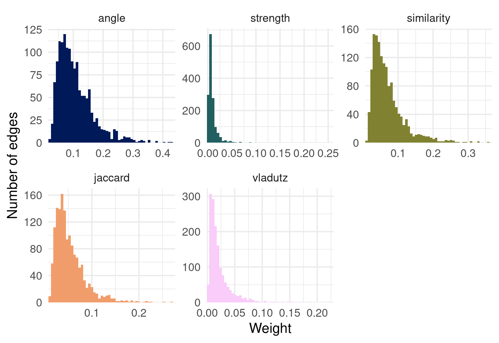
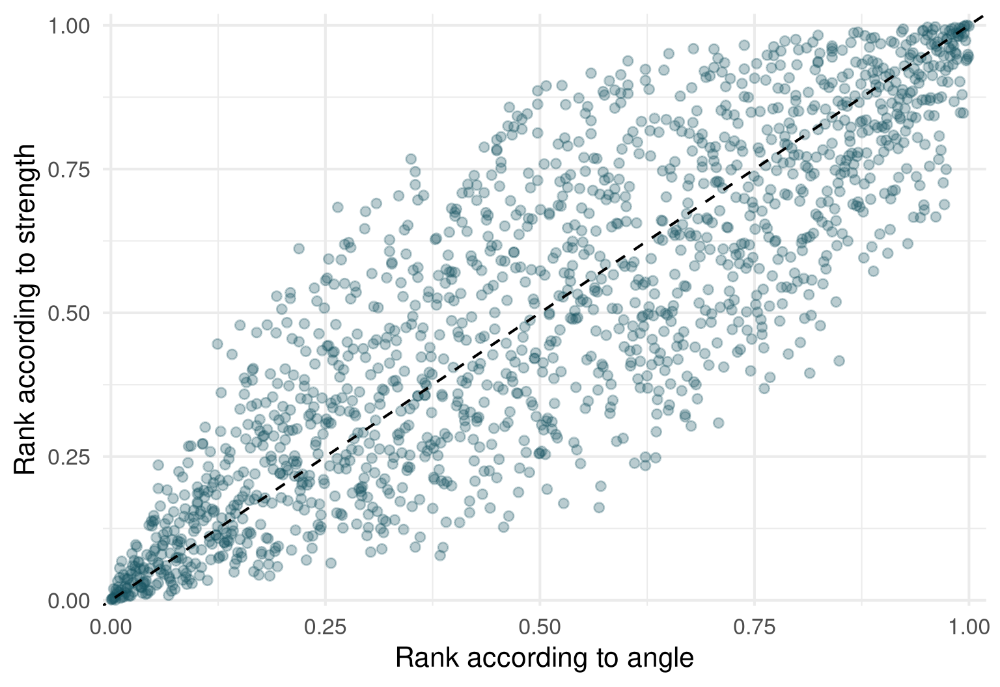

# Does the choice of the coupling measure matter? The stagflation corpus

`biblionetwork` offers several ways of turning the same table of
citations into the weighted edges of a network. This vignette asks a
practical question: **on a real corpus, how much does the choice of the
measure change the network?** We use the corpus of the literature
explaining the US stagflation of the 1970s ([Goutsmedt
2021](#ref-goutsmedt2021a)), included in the package: `Ref_stagflation`
lists the documents that explain the stagflation and the references they
cite. We go through five questions: the intuition of each measure, the
distribution of their weights, the agreement of their rankings, the
pairs on which they disagree, and the communities they produce.

``` r
library(biblionetwork)
library(data.table)
```

## Five ways of saying “these two documents are close”

Two documents are *coupled* when they cite the same references ([Kessler
1963](#ref-kessler1963)). All the measures start from the number of
shared references, and differ in what they do with it. The intuition of
each is detailed in the documentation of the function; here is the short
version.

| Measure | Function | Intuition |
|----|----|----|
| Coupling angle | [`coupling_angle()`](https://agoutsmedt.github.io/biblionetwork/reference/coupling_angle.md) | Shared references, relative to the length of the two bibliographies (a cosine) ([Sen and Gan 1983](#ref-sen1983)). Two shopping lists with many common items. |
| Jaccard | [`coupling_jaccard()`](https://agoutsmedt.github.io/biblionetwork/reference/coupling_jaccard.md) | Of everything the two documents cite, the share they cite both. Penalises more strongly bibliographies of very different lengths. |
| Coupling strength | [`coupling_strength()`](https://agoutsmedt.github.io/biblionetwork/reference/coupling_strength.md) | A shared *rare* reference counts more than a shared classic, with the weight \log(N/f_j) of the tf-idf ([Vladutz and Cook 1984](#ref-vladutz1984); [Shen et al. 2019](#ref-shen2019)). |
| Similarity | [`coupling_similarity()`](https://agoutsmedt.github.io/biblionetwork/reference/coupling_similarity.md) | The same idea, but as a cosine: the “informational size” of a bibliography is the total rarity of its references ([Shen et al. 2019](#ref-shen2019)). |
| Vladutz-Cook | [`coupling_vladutz()`](https://agoutsmedt.github.io/biblionetwork/reference/coupling_vladutz.md) | A shared reference counts 1/f_j: a very steep discount of popular references ([Vladutz and Cook 1984](#ref-vladutz1984)). |

[`compute_couplings()`](https://agoutsmedt.github.io/biblionetwork/reference/compute_couplings.md)
computes them all on the same pairs of documents. We keep the pairs
sharing at least two references, a common way of ignoring the weakest
ties.

``` r
edges <- compute_couplings(Ref_stagflation,
                           source = "Citing_ItemID_Ref",
                           ref = "ItemID_Ref",
                           weight_threshold = 2)
sapply(edges, nrow)
```

    #>      angle   strength similarity    jaccard    vladutz
    #>       1501       1501       1501       1501       1501

All the measures describe the same 1501 edges: they only differ by the
weight given to each.

## The distributions of the weights

The measures do not have the same scale: the cosines and the Jaccard
index are bounded by 1, the coupling strength is not, and the typical
values differ. The means and quantiles are therefore not comparable
across measures. The last column, `ratio_q99_median`, is: the larger it
is, the heavier the right tail (a few very strong ties, many weak ones).

``` r
summarise_weights(edges)[, .(method, n_edges, mean = round(mean, 3), median = round(q50, 3),
                              q99 = round(q99, 3), max = round(max, 3),
                              ratio_q99_median = round(ratio_q99_median, 1))]
```

    #>        method n_edges  mean median   q99   max ratio_q99_median
    #>        <char>   <int> <num>  <num> <num> <num>            <num>
    #> 1:      angle    1501 0.108  0.093 0.312 0.429              3.4
    #> 2:   strength    1501 0.009  0.006 0.051 0.254              8.4
    #> 3: similarity    1501 0.071  0.058 0.249 0.358              4.3
    #> 4:    jaccard    1501 0.054  0.044 0.176 0.269              4.0
    #> 5:    vladutz    1501 0.022  0.015 0.113 0.223              7.6

``` r
plot_weights(edges)
```



Measures that discount popular references (strength, Vladutz-Cook) have
heavier right tails than the cosines: the weights are concentrated on a
minority of pairs that share rare references. If you later filter edges
with a weight threshold, or use a community detection algorithm
sensitive to the weights, this shape matters.

## Do the measures rank the pairs in the same way?

The scale differs but what matters in most uses (a threshold, a “top
10%”, a community detection) is the *order* of the pairs.
[`correlate_weights()`](https://agoutsmedt.github.io/biblionetwork/reference/correlate_weights.md)
computes the Spearman rank correlation between measures (1: same
ranking).

``` r
round(correlate_weights(edges), 2)
```

    #>            angle strength similarity jaccard vladutz
    #> angle       1.00     0.85       0.96    0.98    0.69
    #> strength    0.85     1.00       0.90    0.81    0.73
    #> similarity  0.96     0.90       1.00    0.94    0.84
    #> jaccard     0.98     0.81       0.94    1.00    0.70
    #> vladutz     0.69     0.73       0.84    0.70    1.00
    #> attr(,"n_pairs")
    #> [1] 1501

Correlations are one thing;
[`overlap_top_weights()`](https://agoutsmedt.github.io/biblionetwork/reference/overlap_top_weights.md)
asks a question closer to network analysis: among the 10% strongest
edges of each measure, how many are shared by two measures?

``` r
round(overlap_top_weights(edges, top = 0.1), 2)
```

    #>            angle strength similarity jaccard vladutz
    #> angle       1.00     0.39       0.77    0.79    0.40
    #> strength    0.39     1.00       0.45    0.37    0.35
    #> similarity  0.77     0.45       1.00    0.66    0.50
    #> jaccard     0.79     0.37       0.66    1.00    0.38
    #> vladutz     0.40     0.35       0.50    0.38    1.00
    #> attr(,"n_top")
    #>      angle   strength similarity    jaccard    vladutz
    #>        151        151        151        151        151

``` r
plot_weights(edges, type = "scatter", x = "angle", y = "strength")
```



The measures that only normalise the number of shared references (angle,
Jaccard) and the idf cosine are close. The measures that discount
popular references (strength, Vladutz-Cook) form another group, which
agrees less with the first one, especially among the strongest edges.
This is the pattern that Shen et al. ([2019](#ref-shen2019)) report on a
corpus of library and information science documents (a very high
correlation between the angle and the idf similarity, a lower one with
the others): it holds here too.

## Where do they disagree? Pairs of documents

Let us look at the pairs on which the coupling angle and the coupling
strength disagree the most.
[`merge_weights()`](https://agoutsmedt.github.io/biblionetwork/reference/merge_weights.md)
puts the weights side by side, ranks the pairs under each measure (rank
1: the strongest pair) and, for two measures, computes the **rank gap**:
the rank under the second measure minus the rank under the first. A
large positive gap means that the first measure finds the pair close and
the second does not. We then label the documents with
`Nodes_stagflation`.

``` r
ranks <- merge_weights(edges[c("angle", "strength")], rank_gap = c("angle", "strength"))

labels <- unique(Nodes_stagflation[, .(ItemID_Ref, Author_date)])
ranks[, `:=`(document_1 = labels$Author_date[match(Source, labels$ItemID_Ref)],
             document_2 = labels$Author_date[match(Target, labels$ItemID_Ref)])]
show <- function(x) x[, .(document_1, document_2, angle = round(angle, 2), strength = round(strength, 3),
                          rank_angle, rank_strength, rank_gap)]
```

Pairs that the angle ranks high and the strength ranks low: they share
many references, but mostly popular ones.

``` r
show(ranks[order(-rank_gap)][1:5])
```

    #>          document_1         document_2 angle strength rank_angle rank_strength
    #>              <char>             <char> <num>    <num>      <num>         <num>
    #> 1:    HETZEL-R-2008     MELTZER-A-2005  0.16    0.005      228.0           877
    #> 2:    HETZEL-R-2008   PRIMICERI-G-2006  0.15    0.005      279.5           909
    #> 3:    HETZEL-R-2008 ORPHANIDES-A-2003b  0.10    0.003      648.0          1260
    #> 4: PRIMICERI-G-2006       LEVIN-A-2013  0.13    0.004      439.0          1039
    #> 5:    HETZEL-R-2008     DICECIO-C-2013  0.14    0.005      359.0           949
    #>    rank_gap
    #>       <num>
    #> 1:    649.0
    #> 2:    629.5
    #> 3:    612.0
    #> 4:    600.0
    #> 5:    590.0

Pairs that the strength ranks higher than the angle: they share fewer
references, but rare ones.

``` r
show(ranks[order(rank_gap)][1:5])
```

    #>          document_1       document_2 angle strength rank_angle rank_strength
    #>              <char>           <char> <num>    <num>      <num>         <num>
    #> 1: HELLIWELL-J-1988     GRUBB-D-1982  0.07    0.009     1105.0           476
    #> 2:     BRUNO-M-1984     GRUBB-D-1982  0.07    0.011      977.0           350
    #> 3:   GORDON-R-1975b     MORK-K-1978a  0.09    0.015      805.0           215
    #> 4:     BALL-L-1995a ROTEMBERG-J-1996  0.06    0.008     1173.0           584
    #> 5:    RASCHE-R-1981     TATOM-J-1978  0.08    0.011      969.5           383
    #>    rank_gap
    #>       <num>
    #> 1:   -629.0
    #> 2:   -627.0
    #> 3:   -590.0
    #> 4:   -589.0
    #> 5:   -586.5

To understand a pair, look at the references it shares. For the pair
with the largest rank gap:

``` r
pair <- ranks[order(-rank_gap)][1]
refs_of <- function(id) Ref_stagflation$ItemID_Ref[Ref_stagflation$Citing_ItemID_Ref == id]
shared <- intersect(refs_of(pair$Source), refs_of(pair$Target))
n_citing <- table(Ref_stagflation$ItemID_Ref)
data.table(reference = labels$Author_date[match(shared, labels$ItemID_Ref)],
           cited_by_n_documents = as.integer(n_citing[as.character(shared)]))[order(-cited_by_n_documents)]
```

    #>              reference cited_by_n_documents
    #>                 <char>                <int>
    #>  1:     SARGENT-T-1999                   32
    #>  2:     CLARIDA-R-2000                   28
    #>  3: ORPHANIDES-A-2003a                   26
    #>  4:   FRIEDMAN-M-1968a                   20
    #>  5:     TAYLOR-J-1999a                   18
    #>  6:       MAYER-T-1998                   16
    #>  7:      BARRO-R-1983a                   14
    #>  8:      HETZEL-R-1998                   12
    #>  9:     MELTZER-A-2010                   11
    #> 10:      NELSON-E-2005                   11
    #> 11:      LUCAS-R-1972a                   10
    #> 12:       BORDO-M-1999                    3

The measure answers a question, and the question is not the same: *do
these documents cite the same things?* (angle) or *do they cite the same
things that few others cite?* (strength). Which one you need depends on
your research question: mapping the shared foundations of the corpus, or
its specialised sub-communities.

## Does it change the communities?

A network is rarely an end in itself: the usual next step is to detect
communities. We run the Louvain algorithm on the weighted network of
each measure, and compare the partitions with the adjusted Rand index
(1: identical partitions, around 0: as different as random ones).

``` r
set.seed(2024)
partitions <- lapply(edges, function(x) {
  graph <- igraph::graph_from_data_frame(x[, .(from = Source, to = Target, weight)], directed = FALSE)
  igraph::cluster_louvain(graph)
})
data.table(measure = names(partitions),
           communities = sapply(partitions, length),
           modularity = round(sapply(partitions, igraph::modularity), 2))
```

    #>       measure communities modularity
    #>        <char>       <int>      <num>
    #> 1:      angle           7       0.31
    #> 2:   strength           9       0.46
    #> 3: similarity           7       0.35
    #> 4:    jaccard           7       0.31
    #> 5:    vladutz           7       0.45

``` r
membership <- sapply(partitions, function(p) igraph::membership(p)[names(igraph::membership(partitions$angle))])
agreement <- outer(names(partitions), names(partitions),
                   Vectorize(function(a, b) igraph::compare(membership[, a], membership[, b], method = "adjusted.rand")))
dimnames(agreement) <- list(names(partitions), names(partitions))
round(agreement, 2)
```

    #>            angle strength similarity jaccard vladutz
    #> angle       1.00     0.63       0.94    0.90    0.65
    #> strength    0.63     1.00       0.61    0.64    0.69
    #> similarity  0.94     0.61       1.00    0.90    0.70
    #> jaccard     0.90     0.64       0.90    1.00    0.70
    #> vladutz     0.65     0.69       0.70    0.70    1.00

The idf-weighted measures do not just reweight the edges: they can
regroup the documents differently. The partitions of the angle, the
Jaccard index and the idf similarity are close to each other, while the
partitions of the coupling strength and Vladutz-Cook are further away
from them. (Louvain is a stochastic algorithm, and the exact numbers
depend on the seed and on the version of `igraph`: what matters is the
order of magnitude of the differences.)

Once you know *that* the partitions differ, the substantive work is to
read them: who are the documents of the communities that change?
`networkflow` provides the tools to name and plot the communities.

## Co-citation: the mirror image

[`biblio_cocitation()`](https://agoutsmedt.github.io/biblionetwork/reference/biblio_cocitation.md)
links *cited* references that are cited together. The same measures
exist, with the roles swapped: the shared items are now the citing
documents. With the idf measures, a document that cites few references
is a more specific witness of the closeness of two references than a
document that cites many (see
[`?biblio_cocitation`](https://agoutsmedt.github.io/biblionetwork/reference/biblio_cocitation.md)).

``` r
cocitation <- compute_couplings(Ref_stagflation,
                                source = "Citing_ItemID_Ref",
                                ref = "ItemID_Ref",
                                weight_threshold = 2,
                                network = "cocitation")
sapply(cocitation, nrow)
```

    #>      angle   strength similarity    jaccard    vladutz
    #>       4499       4499       4499       4499       4499

``` r
round(correlate_weights(cocitation), 2)
```

    #>            angle strength similarity jaccard vladutz
    #> angle       1.00     0.91       0.99    0.95    0.72
    #> strength    0.91     1.00       0.91    0.85    0.66
    #> similarity  0.99     0.91       1.00    0.95    0.77
    #> jaccard     0.95     0.85       0.95    1.00    0.78
    #> vladutz     0.72     0.66       0.77    0.78    1.00
    #> attr(,"n_pairs")
    #> [1] 4499

``` r
round(overlap_top_weights(cocitation, top = 0.1), 2)
```

    #>            angle strength similarity jaccard vladutz
    #> angle       1.00     0.67       0.93    0.96    0.28
    #> strength    0.67     1.00       0.71    0.65    0.33
    #> similarity  0.93     0.71       1.00    0.89    0.30
    #> jaccard     0.96     0.65       0.89    1.00    0.29
    #> vladutz     0.28     0.33       0.30    0.29    1.00
    #> attr(,"n_top")
    #>      angle   strength similarity    jaccard    vladutz
    #>        450        450        450        470        450

## Authors rather than documents: the entity level

[`entity_network()`](https://agoutsmedt.github.io/biblionetwork/reference/entity_network.md)
does not add a measure: it computes the measures above for entities
(here the first authors of the stagflation documents) rather than
documents, through the documents they publish, with the minimum rule of
Zhao and Strotmann ([2008](#ref-zhao2008b)). It accepts all the methods
(`"angle"`, `"strength"`, `"similarity"`, `"jaccard"`, `"vladutz"`), and
`network = "cocitation"` for the entities of the cited references.

``` r
Ref_stagflation$Citing_ItemID_Ref <- as.character(Ref_stagflation$Citing_ItemID_Ref)
entity_citations <- merge(Ref_stagflation, Nodes_stagflation,
                          by.x = "Citing_ItemID_Ref", by.y = "ItemID_Ref")
methods <- c("angle", "strength", "similarity", "jaccard", "vladutz")
entities <- lapply(methods, function(method) {
  entity_network(entity_citations, source = "Citing_ItemID_Ref", ref = "ItemID_Ref",
                 entity = "Author.y", weight_threshold = 2, method = method)
})
names(entities) <- methods
sapply(entities, nrow)
```

    #>      angle   strength similarity    jaccard    vladutz
    #>        946        946        946        946        946

``` r
round(correlate_weights(entities), 2)
```

    #>            angle strength similarity jaccard vladutz
    #> angle       1.00     0.83       0.96    0.97    0.71
    #> strength    0.83     1.00       0.87    0.83    0.74
    #> similarity  0.96     0.87       1.00    0.92    0.85
    #> jaccard     0.97     0.83       0.92    1.00    0.73
    #> vladutz     0.71     0.74       0.85    0.73    1.00
    #> attr(,"n_pairs")
    #> [1] 946

## A sixth measure, not computed by default: using the titles

[`coupling_descriptive()`](https://agoutsmedt.github.io/biblionetwork/reference/coupling_descriptive.md)
is the DescriptiveBC measure of Liu ([2017](#ref-liu2017)): two
documents can be coupled even if they cite *different* references,
provided that the titles of these references share words. It is not one
of the measures computed by default by
[`compute_couplings()`](https://agoutsmedt.github.io/biblionetwork/reference/compute_couplings.md),
since its cost grows with the square of the number of documents, and its
pairs are not the same as the others (documents sharing no reference can
be linked). You can ask for it with `methods = "descriptive"` and the
column of the titles; the function says so with a message. On a large
corpus, restrict it to some `targets` through `descriptive_args`.

``` r
with_titles <- compute_couplings(Ref_stagflation,
                                 source = "Citing_ItemID_Ref",
                                 ref = "ItemID_Ref",
                                 methods = c("angle", "descriptive"),
                                 weight_threshold = 2,
                                 title = "Title",
                                 descriptive_args = list(stopwords = c("the", "of", "and", "a", "in", "on", "for", "to")))
merge_weights(with_titles)[order(-descriptive)][1:5]
```

    #>        Source     Target     angle descriptive rank_angle rank_descriptive
    #>        <char>     <char>     <num>       <num>      <num>            <num>
    #> 1:  106566092   22082000 0.4206671   0.5503356        2.0                1
    #> 2: 1111111150   25091445 0.4291975   0.4981252        1.0                2
    #> 3:  101742296  106566093 0.3380617   0.4976126        9.5                3
    #> 4:  106371053   22082000 0.3579170   0.4882313        6.0                4
    #> 5:  106566093 1111111117 0.3563483   0.4837800        7.0                5
    #>    rank_gap
    #>       <num>
    #> 1:     -1.0
    #> 2:      1.0
    #> 3:     -6.5
    #> 4:     -2.0
    #> 5:     -2.0

Some references have several different titles in the table (the function
warns, and uses the first); the pairs of documents of `descriptive` are
far more numerous than those of the other measures, which only link
documents sharing at least two references. The ranks are computed on the
pairs the two measures have in common.

## What to remember

- **The measures answer different questions.** The angle and the Jaccard
  index ask whether two documents cite the same things; the strength,
  the similarity and Vladutz-Cook ask whether they cite the same things
  *that few others cite*. The cosine form of the similarity makes it
  comparable in scale to the angle.
- **The choice can change the communities, not only the weights.** Check
  on your corpus, as done here, before choosing:
  [`compute_couplings()`](https://agoutsmedt.github.io/biblionetwork/reference/compute_couplings.md)
  makes it a matter of a few lines.
- **Report the measure.** Since the measures do not give the same
  networks, a study should state which one it uses, and why.

## References

Goutsmedt, Aurélien. 2021. “From the Stagflation to the Great Inflation:
Explaining the US Economy of the 1970s.” *Revue d’Economie Politique*
Forthcoming.
<https://aurelien-goutsmedt.com/media/pdf/stagflation-great-inflation.pdf>.

Kessler, M. M. 1963. “Bibliographic Coupling Between Scientific Papers.”
*American Documentation* 14 (1): 10–25.
<https://doi.org/10.1002/asi.5090140103>.

Liu, Rey-Long. 2017. “A New Bibliographic Coupling Measure with
Descriptive Capability.” *Scientometrics* 110 (2): 915–35.
<https://doi.org/10.1007/s11192-016-2196-7>.

Sen, Subir K., and Shymal K. Gan. 1983. “A Mathematical Extension of the
Idea of Bibliographic Coupling and Its Applications.” *Annals of Library
Science and Documentation* 30 (2).

Shen, Si, Danhao Zhu, Ronald Rousseau, Xinning Su, and Dongbo Wang.
2019. “A Refined Method for Computing Bibliographic Coupling Strengths.”
*Journal of Informetrics* 13 (2): 605–15.
<https://linkinghub.elsevier.com/retrieve/pii/S1751157716300244>.

Vladutz, George, and James Cook. 1984. “Bibliographic Coupling and
Subject Relatedness.” *Proceedings of the American Society for
Information Science* 21: 204–7.

Zhao, Dangzhi, and Andreas Strotmann. 2008. “Author Bibliographic
Coupling: Another Approach to Citation-Based Author Knowledge Network
Analysis.” *Proceedings of the American Society for Information Science
and Technology* 45 (1): 1–10.
<https://asistdl.onlinelibrary.wiley.com/doi/full/10.1002/meet.2008.1450450292>.
